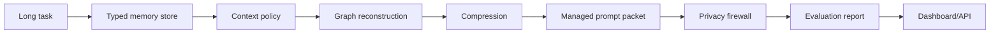

# ContextOps Agent

[](https://github.com/PRINCE2-AI/contextops-agent/actions/workflows/ci.yml)
[](https://www.python.org/)
[](https://platform.openai.com/docs)
[](https://fastapi.tiangolo.com/)
[](https://streamlit.io/)
[](LICENSE)

**Context engineering, memory, privacy, and evaluation infrastructure for long-horizon AI agents.**

ContextOps Agent is a production-style context layer for long-horizon LLM agents. It stores typed memory, preserves plans and constraints, reconstructs relevant context, compresses stale history, blocks private-data leakage to tools, and reports measurable quality metrics.

Research basis:

- **AdaCoM**: external context management for long-horizon agents.
- **MRAgent**: active memory reconstruction instead of static retrieval.
- **Plans Don't Persist**: explicit plan state outside the model context.
- **ToolPrivacyBench**: privacy leakage evaluation for tool-using agents.
- **AgenticSTS / ContextBudget**: bounded context and typed state evaluation.

> [!NOTE]
> This is a practical portfolio implementation inspired by current research. It does not claim benchmark-level SOTA or exact reproduction of any paper.

## See It In Action

```bash
python demo.py
```

Observed demo evidence from the validated portfolio run:

```json
{
  "selected_memories": 5,
  "compression_ratio": 0.152,
  "privacy_decision": "block",
  "leak_count": 2,
  "task_success_score": 1.0,
  "plan_retention_score": 1.0,
  "memory_precision": 1.0
}
```

The demo seeds a long-horizon agent memory with goals, constraints, prior failures, research notes, and synthetic private data. ContextOps builds a managed prompt, compresses non-critical context, blocks secret-like tool payloads, and scores the run.

## Why This Project

Most agent demos append every message to the prompt until quality collapses. ContextOps focuses on the real infrastructure problem:

- agents forget plans and constraints
- raw transcript stuffing wastes tokens
- vector top-k retrieval misses task structure
- private data can leak into tool calls
- agent quality needs measurable evals, not vibes

ContextOps turns this into a concrete system with typed memory, policy decisions, graph reconstruction, compression, privacy checks, and metrics.

## Architecture



## Features

- Typed memory: goals, constraints, decisions, tool results, failures, preferences, private data.
- Provenance tracking for every memory item.
- Context policy with `keep`, `compress`, `drop`, `pin`, and `retrieve` actions.
- Lightweight graph memory reconstruction using shared tags.
- Token-budget-aware managed prompt generation.
- Privacy firewall that redacts or blocks emails, local paths, and secret-like values.
- Evaluation metrics for task success, plan retention, memory precision, privacy score, and token savings.
- FastAPI endpoint and Streamlit dashboard.
- Deterministic demo and CI-ready tests.
- Deterministic local evaluation by default; OpenAI key/model settings are surfaced by `/health`, but the demo makes no model calls.

## Quick Start

```bash
python -m venv .venv
```

Windows PowerShell:

```powershell
.\.venv\Scripts\Activate.ps1
pip install -r requirements.txt
Copy-Item .env.example .env
python demo.py
```

macOS/Linux:

```bash
source .venv/bin/activate
pip install -r requirements.txt
cp .env.example .env
python demo.py
```

Run tests:

```bash
pytest -q
```

No-dependency smoke test:

```bash
python tests/run_tests.py
```

Run API:

```bash
uvicorn app.api:api --reload
```

Run dashboard:

```bash
streamlit run app/ui.py
```

## API

| Endpoint | Purpose |
| --- | --- |
| `GET /health` | Check OpenAI config, token budget, and DB path |
| `POST /run-contextops` | Build a managed context packet, review privacy, and return eval metrics |

Example:

```json
{
  "task": "Use OpenAI API and preserve privacy while compressing stale context.",
  "tool_payload": {
    "query": "Research context engineering. token=sk-test-private"
  },
  "required_terms": ["OpenAI API", "privacy", "compression"]
}
```

## Evaluation Signals

| Metric | Meaning |
| --- | --- |
| `task_success_score` | Required concepts preserved in the managed prompt |
| `plan_retention_score` | Whether goals, constraints, or decisions survive context selection |
| `memory_precision` | Fraction of selected memories with useful relevance score |
| `privacy_score` | Penalty-adjusted score from privacy findings |
| `token_savings_ratio` | Estimated savings versus raw memory stuffing |

## Safety Boundaries

ContextOps is a portfolio-grade context layer, not a hardened production agent runtime. Production use should add policy-as-code, audit logs, encryption for private memory, explicit user approval for high-risk tools, and sandboxing around all external tool execution.

## Resume Bullets

- Built ContextOps Agent, a research-backed context engineering layer for long-horizon LLM agents using typed memory, plan persistence, graph-based memory reconstruction, and token-budget-aware prompt assembly.
- Implemented a privacy firewall for tool calls that redacts or blocks emails, local paths, and secret-like values, plus evaluation metrics for task retention, memory precision, privacy score, and token savings.
- Added FastAPI, Streamlit observability, SQLite memory storage, deterministic demo flows, CI tests, and recruiter-ready documentation based on AdaCoM, MRAgent, ToolPrivacyBench, and long-horizon agent evaluation research.

## Roadmap

- Add OpenAI structured-output memory extraction.
- Add LangGraph adapter for real agent loops.
- Add encrypted private-memory partition.
- Add benchmark pack for multi-step research and coding tasks.
- Add GitHub issue/task ingestion.
