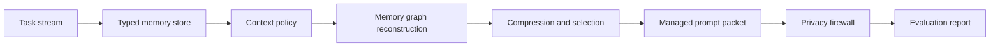

# ContextOps Agent Case Study

## Problem

Long-horizon agents degrade when every message, tool result, and instruction is appended into one growing prompt. They forget plans, lose constraints, waste tokens, and can leak private data into tool calls. ContextOps Agent treats context as an engineering layer instead of a passive transcript.

## Research Basis

- AdaCoM: external context management for long-horizon agents.
- MRAgent: active memory reconstruction before generation.
- Plans Don't Persist: explicit plan and constraint state outside the model context.
- ToolPrivacyBench: privacy leakage evaluation for tool-using agents.
- ContextBudget / AgenticSTS: bounded context and structured state evaluation.

## System Design

## Engineering Decisions

- Used typed SQLite memory instead of a raw chat transcript so goals, constraints, decisions, failures, and private data can be handled differently.
- Added keep, compress, drop, pin, and retrieve actions so context selection is explainable.
- Reconstructed related memories through lightweight graph tags before building the prompt.
- Added a privacy firewall before tool use to block emails, Windows paths, and token-like values.
- Kept a deterministic local fallback so tests and demos run without paid API calls.

## Validation Evidence

| Signal | Result |
| --- | --- |
| Smoke tests | 5 tests passed |
| Demo compression ratio | 0.152 |
| Privacy decision | block |
| Leak count detected | 2 |
| Task success score | 1.0 |
| Plan retention score | 1.0 |
| Memory precision | 1.0 |
| GitHub Actions | CI observed successful on the published repository |

## Why It Matters For AI Engineering

This project demonstrates agent infrastructure beyond prompting: state management, memory selection, context budgeting, privacy review, deterministic evaluation, API design, and dashboard observability.

## Limitations

- The evaluation set is intentionally small and demo-focused.
- The memory graph is lightweight and not a full knowledge graph.
- Privacy controls are guardrails, not compliance-grade enforcement.
- Production deployment should add encryption, audit logs, policy-as-code, and stricter tool sandboxing.

## Next Improvements

- Add OpenAI structured-output memory extraction.
- Add LangGraph-native nodes for agent loop integration.
- Add a larger long-horizon benchmark pack.
- Add LangSmith or Langfuse trace export for observability.
